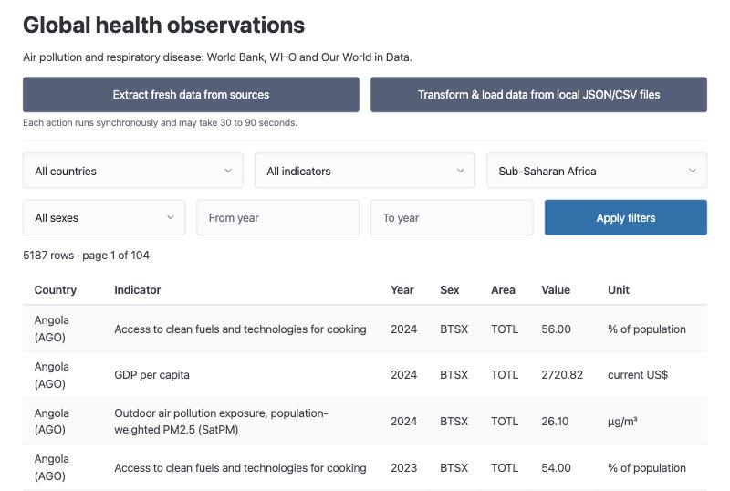
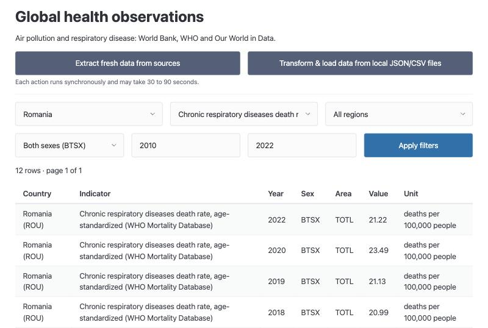
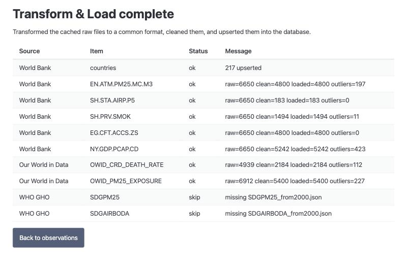
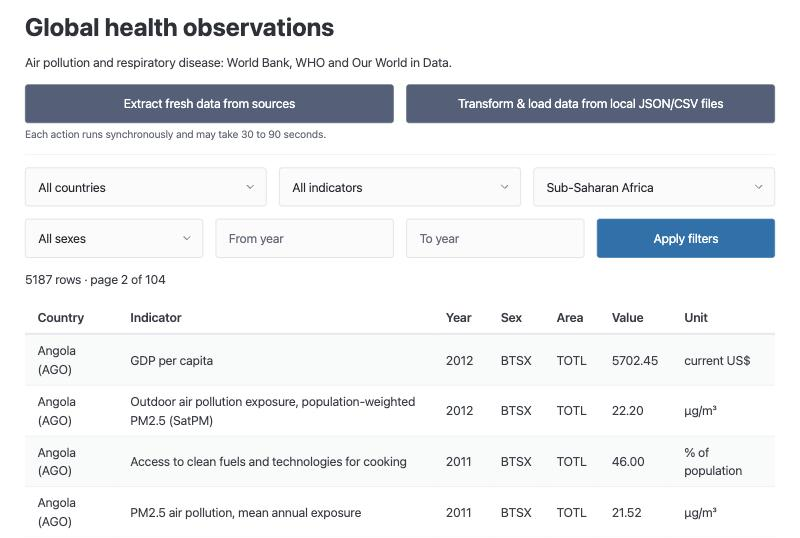

# Lab 3 – Results

The web application was run on 17 November 2026 on macOS 27 (Python 3.14.8, FastAPI 0.162.0,
Starlette 1.10.0, Jinja2 3.1.6, PostgreSQL 18.6), with `uvicorn app.main:app --reload`, on
the data imported in Lab 2. The test suite (`python -m pytest`) passed: **64 passed**.

| Test file | Layer | Tests |
| --- | --- | --- |
| `tests/test_observation_service.py` | service (fake repository) | 12 |
| `tests/test_etl_service.py` | service (stub jobs) | 5 |
| `tests/test_observation_repository.py` | data access (PostgreSQL, temporary schema) | 20 |
| `tests/test_observation_controller.py` | presentation (`TestClient` + database) | 15 |
| `tests/test_etl_controller.py` | presentation (`TestClient`, fake service) | 6 |
| `tests/test_architecture.py` | architecture (Task 3.4) | 6 |

## Task 3.1 – The application running

### Filter combination 1: one region (also used for Task 3.2)

`http://127.0.0.1:8000/?region=Sub-Saharan+Africa`: the 5,187 observations of the countries in
this region, 50 per page, so 104 pages.



### Filter combination 2: country, indicator, sex and years

`http://127.0.0.1:8000/?country=ROU&indicator=OWID_CRD_DEATH_RATE&region=&sex=BTSX&year_from=2010&year_to=2022`:
the chronic respiratory diseases death rate of Romania, both sexes, 2010–2022. This gives
12 rows, because the WHO Mortality Database has no value for 2021.



**From URL to HTML for this screenshot.** The browser sends
`GET /?country=ROU&indicator=OWID_CRD_DEATH_RATE&region=&sex=BTSX&year_from=2010&year_to=2022`.

1. FastAPI matches `GET /` to `show_observations()` in
   `app/controllers/observation_controller.py`. Before calling it, FastAPI resolves its
   dependencies:
   - `observation_criteria()` (same file) turns the query parameters into
     `ObservationCriteria(country_iso3="ROU", indicator_code="OWID_CRD_DEATH_RATE",
     region=None, year_from=2010, year_to=2022, sex=Sex.BOTH)`. The empty `region=` becomes
     `None` through `blank_to_none()`, the years go through `to_int_or_none()` and the sex
     code through `to_sex_or_none()`.
   - `get_observation_service()` (`app/dependencies.py`) calls `get_db()`
     (`app/database.py`), which opens a session. It passes the session to
     `ObservationRepository(session)` and the repository to `ObservationService(repository)`.
2. The controller calls `ObservationService.get_page(criteria, 1)`
   (`app/services/observation_service.py`). The service computes `offset = 0` from the page
   number and the page size of 50, then calls two repository methods:
   - `ObservationRepository.find(criteria, limit=50, offset=0)`
   - `ObservationRepository.count(criteria)`

   Both are in `app/repositories/observation_repository.py` and build their query with
   `_matching_observations(criteria)`, which adds one `WHERE` condition per filter that is
   set (`_conditions()`). PostgreSQL receives the values as query parameters.
3. The repository returns 12 `ObservationListItem` objects and the count 12. The service
   wraps them in an `ObservationPage` (page 1 of 1, no previous or next page).
4. The controller calls `ObservationService.get_filter_options()`. It returns
   `list_countries()`, `list_indicators()` and `list_regions()` from the repository, and the
   three codes of the `Sex` enum.
5. The controller renders `app/templates/observations.html` with the page, the criteria
   and the options. The template marks the chosen options as `selected` and fills the year
   fields. FastAPI returns the HTML and `get_db()` closes the session.

### An action result page: Transform & load

The **Transform & load** button posts the form to `POST /actions/load`. That reaches
`transform_and_load()` in `app/controllers/etl_controller.py`, then
`EtlService.transform_and_load_all()` in `app/services/etl_service.py`. The service runs
`import_all()` of the World Bank, OWID and WHO import scripts, in that order, on the raw
files downloaded in Lab 2. Each script returns one `StepResult` per item, and
`action_result.html` shows them in a table. The counts are the same as in Lab 2
(`docs/lab2_results.md`), as expected from an idempotent upsert. The two WHO indicators are
`skip`, because the WHO GHO API was unavailable when the data was downloaded (Lab 2).



## Task 3.2 – The region filter, from the form to the SQL and back

1. **View.** In `observations.html`, the filter form has `method="get"`. Its
   `<select name="region">` lists the regions from `FilterOptions.regions`. Choosing
   "Sub-Saharan Africa" and clicking *Apply filters* makes the browser request
   `/?country=&indicator=&region=Sub-Saharan+Africa&sex=&year_from=&year_to=`, because every
   form field is sent and untouched fields are empty strings. Opening
   `/?region=Sub-Saharan+Africa` directly gives the same page.
2. **Controller.** `observation_criteria()` has a parameter named `region`, so FastAPI
   fills it from the query string with the text "Sub-Saharan Africa". `blank_to_none()`
   keeps it and turns the empty fields into `None`. The result is
   `ObservationCriteria(region="Sub-Saharan Africa")`, a frozen dataclass from
   `app/domain.py` that the lower layers can read but not change. The controller knows
   nothing about SQL.
3. **Service.** `get_page(criteria, number)` passes the criteria unchanged to the
   repository and adds only the paging rule: `limit=50`, `offset=(number - 1) * 50`.
4. **Repository.** `_conditions()` appends `Country.region == criteria.region` because the
   region is set. SQLAlchemy turns this into `WHERE country.region = %(region_1)s` and sends
   the text as a parameter, never pasted into the SQL. `find()` adds the stable order
   (country name, year descending, indicator code, sex, residence area, primary key), and
   `count()` reuses the same conditions. That gives 5,187 rows, so 104 pages.
5. **Back up.** The rows come back as `ObservationListItem` objects, and the service puts
   them in an `ObservationPage` (`has_next` is true). The controller builds the links with
   `request.url.include_query_params(page=2)`, which keeps `region=Sub-Saharan+Africa` in the
   *Next* link. The template marks the option as `selected`, so the drop-down list still
   shows the region.
6. **Next page.** Clicking *Next* requests `/?region=Sub-Saharan+Africa&page=2`, and the
   same chain runs with `offset=50`. Page 2 of 104 still shows only Sub-Saharan countries,
   with the region still selected in the form:



The stable order matters here. Without the primary key at the end of the `ORDER BY`, rows
that tie (same country and year) could move between the queries of page 1 and page 2.
They would then appear twice or not at all. `test_limit_and_offset_page_through_without_gaps_or_repeats`
checks this.

## Task 3.3 – The sex filter through all the layers

| Layer | Change |
| --- | --- |
| Domain (`app/domain.py`) | `ObservationCriteria.sex: Sex \| None`; `FilterOptions.sexes` |
| Data access (`observation_repository.py`) | `_conditions()` adds `Observation.sex == criteria.sex` when the sex is set |
| Service (`observation_service.py`) | `get_filter_options()` offers the three codes of the `Sex` enum (`BTSX`, `MLE`, `FMLE`) with readable labels |
| Presentation (`form_fields.py`, `observation_controller.py`) | `observation_criteria()` takes a `sex` parameter; `to_sex_or_none()` ignores unknown codes, so `?sex=XYZ` shows every row instead of an HTTP 422 error |
| View (`observations.html`) | a drop-down list "All sexes / Both sexes (BTSX) / Male (MLE) / Female (FMLE)" that keeps the chosen value |

To make the column read back as a `Sex` member instead of a plain string,
`app/models.py` declares `sex`, and also `residence_area`, as a non-native SQLAlchemy
`Enum`. In PostgreSQL the column is still `VARCHAR(10)`, so no migration is needed, and
`alembic check` reports no difference.

Tests added:

- `test_sex_filter_returns_only_rows_of_that_sex`, once for each sex: the repository
  returns only rows of that sex.
- Two new cases in `test_filters_apply_to_find_and_count`.
- `test_sex_filter_shows_one_row_and_stays_selected`: the page
  `/?sex=MLE&country=ROU` shows exactly one row (the seeded Romanian male observation),
  and the option stays selected.
- `test_unknown_sex_code_is_ignored`.

In the real data every observation is `BTSX`. The only indicator split by sex is WHO's
`SDGAIRBODA`, which could not be downloaded, so `/?sex=MLE` returns 0 rows for now. The
filter will matter once the WHO data is imported.

## Task 3.4 – The architecture test

`tests/test_architecture.py` parses `app/domain.py` and every file in `app/repositories/`
and `app/services/` with `ast`, using the `imported_modules()` helper of the handout. It
fails if one of them imports `fastapi`, `app.controllers` or `app.dependencies`, or a module
inside them such as `fastapi.responses`. Each file is a separate test case, so the failure
names the file.

To check that the test really catches a violation, this line was appended on purpose to
`app/services/observation_service.py`:

```python
from fastapi import HTTPException  # Task 3.4: forbidden import, added on purpose
```

`python -m pytest tests/test_architecture.py` then failed:

```
tests/test_architecture.py .....F                                        [100%]

=================================== FAILURES ===================================
_ test_lower_layers_do_not_import_the_web_layer[app/services/observation_service.py] _
>       assert not forbidden, f"{path.relative_to(PROJECT_ROOT)} imports {forbidden}"
E       AssertionError: app/services/observation_service.py imports ['fastapi']
E       assert not ['fastapi']

tests/test_architecture.py:47: AssertionError
=========================== short test summary info ============================
FAILED tests/test_architecture.py::test_lower_layers_do_not_import_the_web_layer[app/services/observation_service.py]
========================= 1 failed, 5 passed in 0.03s ==========================
```

After the line was removed (`git checkout -- app/services/observation_service.py`), the
same command passed: `6 passed in 0.01s`.

The rule matters for two reasons:

- The services can be called without a web request. The import scripts and the tests do
  exactly that (`EtlService` runs the same `import_all()` functions as
  `python -m etl.import_who`).
- A later JSON API (Lab 4) can reuse the same services and repositories unchanged.
